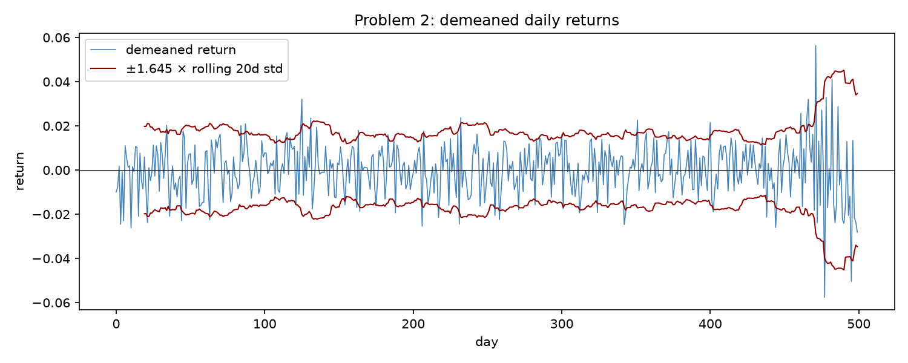
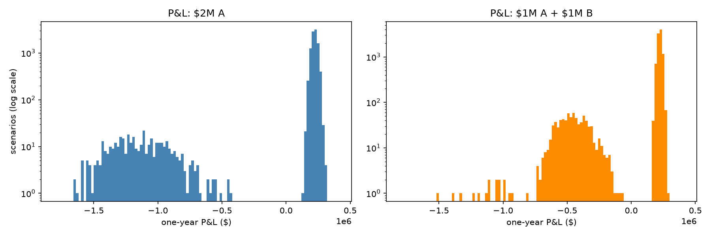
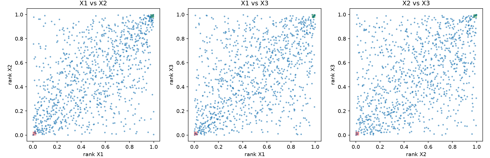

# Assignment 2: Answers

> **Note:** All numbers, tables and plots below come from **`Code.ipynb`** in this folder. Each problem
> there follows the same Predict → Fit → Reconcile order and labels its cells by question letter.
> Plots are saved in `figures/`. Unless stated otherwise, VaR and ES are at α = 5% and reported as positive losses.

---

## Problem 1: Correlations from Mismatched Histories

**Days each pair is jointly observed:**

|     | A   | B   | C   | D  | IDX |
|-----|-----|-----|-----|----|-----|
| A   | 242 | 242 | 221 | 93 | 242 |
| B   | 242 | 242 | 221 | 93 | 242 |
| C   | 221 | 221 | 228 | 83 | 228 |
| D   | 93  | 93  | 83  | 96 | 96  |
| IDX | 242 | 242 | 228 | 96 | 250 |

All five series trade on only **81** of the 250 days. D only exists from day 151.

### Predict

**(a)** The **pairwise** matrix can fail to be PSD. Each entry is estimated on a different set of days, so the entries
don't have to be consistent with each other, and the matrix can imply a portfolio with negative variance. The
**complete-case** matrix is guaranteed PSD. Every entry uses the same 81 rows, so it is the sample correlation of one data
matrix Z, and wᵀZᵀZw = ‖Zw‖² ≥ 0 for every w.

**(b)** If IDX ≈ 0.4A + 0.3B + 0.2C + 0.1D, then the portfolio (−0.4, −0.3, −0.2, −0.1, +1) has almost zero variance. That means
the **true smallest eigenvalue is very close to 0** (only the tracking error keeps it positive). With no room between it and zero,
small inconsistencies between pairwise entries can easily push it negative. So this data set is **highly exposed** to the failure in (a).

**(c)** I expected the correlations with **D** to be the least reliable, especially **C–D (83 days)**, then A–D/B–D (93) and
D–IDX (96). Fewer days means a larger standard error (≈ 1/√n: about 0.11 vs 0.065 for 242 days). They also only cover the second
part of the sample, so if correlations change over time they describe a different period from the other entries.

### Fit

**(d)**

| | Complete case | Pairwise |
|---|---|---|
| Eigenvalues | 0.0015, 0.548, 0.693, 0.870, 2.886 | **−0.0111**, 0.471, 0.528, 0.857, 3.154 |
| Cholesky | Works. The last pivot (IDX) is only 0.049, so the matrix is nearly singular. | **Fails.** numpy says "not positive definite" and the Library's `cholesky_psd` gives NaN at the IDX pivot. |

**(e)** Tracking-portfolio variance with the pairwise covariance = **−1.80 × 10⁻⁶**, which is a negative variance.
(For comparison, the realized tracking variance on the 81 complete days is 3.2 × 10⁻⁷, a tracking error of about 0.06% per day.)

**(f)**

| | Smallest eigenvalue | Frobenius distance from pairwise | Tracking variance |
|---|---|---|---|
| Pairwise (no repair) | −0.0111 | 0 | −1.80 × 10⁻⁶ |
| Rebonato–Jäckel | ≈ 0 (3.6 × 10⁻¹⁷) | 0.0162 | 6.81 × 10⁻⁷ |
| Higham | ≈ 0 (−4.9 × 10⁻¹⁰, within tolerance) | 0.0155 | 6.79 × 10⁻⁷ |

### Reconcile

**(g)** A matrix is PSD if wᵀΣw ≥ 0 for **every** w, i.e. every portfolio has non-negative variance. Equivalently, all eigenvalues
are ≥ 0, since wᵀΣw = Σ λₖ(vₖᵀw)². The pairwise matrix has $\lambda_{\min}$ = −0.011, so any portfolio pointing along that eigenvector gets
negative variance. The tracking portfolio is almost exactly that direction. Its eigenvector (scaled so IDX = 1) is
(−0.48, −0.28, −0.32, −0.25, 1), and the tracking portfolio in correlation units is (−0.54, −0.29, −0.30, −0.19, 1).

**(h)** Higham moved the **IDX entries** most: A–IDX −0.007, C–IDX −0.005, B–IDX −0.004, D–IDX −0.004. It moved the D pairs
by only about 0.001–0.002. **This does not match my answer to (c)**: C–D, the entry I expected to be least reliable, barely changed.
The repair doesn't know how many days are behind each entry. It only uses the **geometry of the matrix**: it removes the
negative-eigenvalue direction with the smallest Frobenius-norm change. That eigenvector is dominated by IDX (loading 0.82),
so the change lands mostly on IDX's row and column.

**(i)** The gap between complete case and pairwise is **0.42** (Frobenius). The repair is only **0.016**, and the two repairs differ
from each other by 0.005. So **the choice of estimator matters about 27× more than the choice of repair.** The reason is that
correlations change over the year: C's correlation with A is 0.53 on days 1–150 but 0.27 on days 151–250. Complete case only
uses days 151+ (because of D), while pairwise mixes both periods. That mixing is also what made the pairwise matrix non-PSD in the first place.

---

## Problem 2: A Volatility Estimate After the Regime Changed

The plot shows calm returns (vol ≈ 1%) for about 460 days, then the **last ~40 days** are much more volatile (vol ≈ 2.4%).
A two-regime likelihood scan gives the best split at 39 days, so I used 40.

### Predict

**(a)** My predicted order, smallest to largest:

1. **Student's t**: fitted to the whole sample. It explains the big days with fat tails (low ν) instead of a bigger scale, and at 5%
   a fat-tailed t has a *smaller* quantile than a normal with the same variance.
2. **Normal, equal-weight σ**: mostly calm days, pulled up a little by the recent ones.
3. **Historical**: the 25th worst day of 500, and many of the worst days are recent, so slightly above the normal.
4. **Normal, EW λ = 0.97**: most weight is on the volatile recent period.
5. **Normal, EW λ = 0.94**: even more weight on the most recent days, so the largest.

The first three should be close together, and the two EW numbers should be close to double those.

**(b)**

| λ | Effective sample size | Half life (days) | Weight on last 40 days |
|---|---|---|---|
| 0.94 | 32.3 | 11.2 | **91.6%** |
| 0.97 | 65.7 | 22.8 | **70.4%** |

**(c)** Mean = 0 (removed), std = 0.0119, skew = −0.16, **excess kurtosis = 2.17**. Under normality the SE of kurtosis is
≈ √(24/500) = 0.22, so 2.17 is about 10 SEs from 0. **A single normal regime could not produce these moments.**

### Fit

**(d)**

| Method | One-day 5% VaR |
|---|---|
| Student's t | **\$18,872** |
| Normal, equal weight | **\$19,594** |
| Historical | **\$20,514** |
| Normal, EW λ = 0.97 | **\$34,619** |
| Normal, EW λ = 0.94 | **\$38,707** |

Fitted t: **μ = 0.00018, σ = 0.01029, ν = 8.27.**

*Note:* the EW σ is computed around the sample mean as instructed (zero-mean returns). The Library's EW function centers
on the EW mean instead, which gives slightly smaller values (2.21% vs 2.35% at λ = 0.94).

### Reconcile

**(e)** The order came out **exactly as I predicted**. The weighting choice (equal vs EW) changes VaR by about 2×, while the choice
of distribution only changes it by about 8%. The t landing below the normal looks strange for a fat-tailed model, but it is expected
at 5%. The t uses ν ≈ 8 to explain the volatile days, so its scale (1.03%) stays near the calm level, and at the 5% point that matters
more than the fatter tail.

**(f)** Calm regime (first 460 days): **σ = 1.02%**, excess kurtosis −0.20. Volatile regime (last 40 days): **σ = 2.43%**, excess
kurtosis 0.03. So **each regime on its own is basically normal**. Mixing 460 days at 1.02% with 40 days at 2.43% implies an
excess kurtosis of about 2.6, which is close to the 2.2 observed. The fat tails come from **the volatility change**, not from
fat tails inside a regime. The fitted t is describing the **mixture of the two regimes**, as if a volatile day could happen at
random any time in the past. It doesn't know the volatile days are the most recent ones, which is why it gives the lowest VaR.

**(g)** $SE(\hat\sigma) \approx \sigma/\sqrt{2 n_{\text{eff}}}$. In VaR terms that is about **\$4,813** for λ = 0.94 and **\$3,021** for λ = 0.97. The gap between the two
EW VaRs is **\$4,088**, which is 0.85 SE of the 0.94 estimate, so **it is not clearly larger than the noise.** Both agree that vol has
roughly doubled.

*Opinion:* I would use **λ = 0.94 for a trading limit**, because it reacts fast (half life ≈ 11 days) and a limit should reflect
the risk being taken now. For **capital** I would use **λ = 0.97 or slower**, plus a stressed or long-window floor. Capital should be
stable and not swing with a few weeks of data, and a larger $n_{\text{eff}}$ gives a smaller standard error.

---

## Problem 3: When Diversification Raises VaR

Each choice has a big spike of small gains (the bond pays off) and a separate cluster of large default losses. For \$2M in A
the losses are about −\$1M to −\$1.6M. For \$1M in each they are about −\$450k when one bond defaults, plus a few rare double defaults.

### Predict

**(a)**

| | Mean | Std | Skew | Excess kurtosis |
|---|---|---|---|---|
| A | 8.37% | 13.60% | −4.82 | 22.1 |
| B | 8.50% | 13.21% | −4.92 | 23.1 |

The returns are extremely skewed and fat-tailed, so they are far from normal. A normal VaR only uses the mean and σ, so it will be
**too pessimistic at 5%** (where the true outcome is still a gain) and **too optimistic deep in the tail** (where defaults lose 50–80%).

**(b)** A loses >20% in **406** scenarios, B in **393**, at least one in **782**, and both in only 17. The 5% tail is **500** scenarios.

- **VaR prediction: diversified VaR is larger.** For \$2M in A, only 406 < 500 scenarios are defaults, so the 5% cutoff lands on a
  no-default scenario and VaR is a *gain*. For \$1M in each, 782 > 500, so the cutoff lands on a one-default scenario, a loss of about \$400k+.
- **ES prediction: diversified ES is smaller.** For \$2M in A the tail average includes all 406 full-size defaults. For \$1M in each the
  tail is mostly single defaults of about half the size.

### Fit

**(c), (d), (e)**

| Position | Hist. VaR 5% | Hist. ES 5% | Normal VaR 5% | Hist. VaR 1% | Hist. ES 1% |
|---|---|---|---|---|---|
| \$1M A | −\$84,570 | \$443,628 | \$139,971 | \$649,701 | \$709,548 |
| \$1M B | −\$86,063 | \$419,587 | \$132,277 | \$640,393 | \$700,805 |
| \$2M A | **−\$169,140** | **\$887,257** | **\$279,941** | **\$1,299,403** | \$1,419,096 |
| \$1M A + \$1M B | **\$414,604** | **\$541,997** | **\$143,466** | **\$598,123** | \$716,408 |

(A negative VaR means the 5% worst outcome is still a profit.)

### Reconcile

**(f)**

- **VaR:** VaR(A) + VaR(B) = −\$170,633, but VaR(A+B) = \$414,604. **Subadditivity is violated.**
- **ES:** ES(A) + ES(B) = \$863,216 ≥ ES(A+B) = \$541,997. **Subadditivity holds.**

**Mechanism:** each bond defaults about 4% of the time, just under the 5% cutoff, so on its own VaR doesn't see the default at all.
Combining two independent bonds nearly doubles the chance that *something* defaults (7.8%), which pushes a default inside the 5% tail.
Each loss got smaller, but VaR only looks at where the quantile falls, not how big the losses beyond it are. ES averages the whole tail,
so it gives credit for the smaller losses.

**(g)** The normal VaR favours the **diversified** portfolio (\$143k vs \$280k). That is the right choice according to ES, but
**for the wrong reason**. The normal only sees σ shrinking by about √2 when you combine two uncorrelated bonds. It never notices that the
default probability crossed the 5% line, and its single-bond VaR (+\$140k) is wrong when the true 5% outcome is an \$85k gain. It got the
right answer by luck.

**(h)** At 1% the cutoff is the 100th worst scenario. For \$2M in A, 406 defaults > 100, so VaR is a full default: **\$1.30M**. For
\$1M in each, only 17 double defaults < 100, so VaR is a single default: **\$598k**. Diversification wins and subadditivity holds again.
**VaR fails when the loss probability is between α and the probability of the combined event** (here between about 4% and 7.8%): each
risk is hidden on its own, but combining them pushes the total past α. So VaR's failure shows up for rare, severe events that are
*just* rare enough to be ignored at the chosen α.

---

## Problem 4: Gaussian or t Copula

### Predict

**(a)**

| | Mean | Std | Skew | Excess kurtosis | Excess kurt. without most extreme day |
|---|---|---|---|---|---|
| X1 | 0.0003 | 0.0119 | −0.03 | −0.12 | −0.19 |
| X2 | −0.0003 | 0.0162 | −0.62 | **7.12** | **1.72** |
| X3 | 0.0009 | 0.0100 | 0.07 | 2.87 | 1.73 |

- **X1 → normal** (no skew, no excess kurtosis).
- **X2 → t.** The 7.1 kurtosis looks out of place: it comes almost entirely from **one −14.3% day (an 8.8σ move)**. Without that
  day it drops to 1.7, which is still clearly fat-tailed.
- **X3 → t** (kurtosis 2.9).

**(b)**

| Pair | Both in worst 2.5% | Both in best 2.5% |
|---|---|---|
| X1–X2 | 6 | 8 |
| X1–X3 | 7 | 12 |
| X2–X3 | 6 | 9 |

Under independence I'd expect only 1000 × 0.025² = **0.625 days** per pair per tail. All pairs are clearly positively dependent,
and the corners look more tightly clustered along the diagonal than the middle of the plot. Both corners are crowded, so I
predicted the **t copula will win**.

### Fit

**(c)**

| | AICc normal | AICc t | Chosen |
|---|---|---|---|
| X1 | **−6022.5** | −6020.5 (ν → ∞) | **Normal** |
| X2 | −5408.5 | **−5518.2** (ν = 5.27) | **t** |
| X3 | −6365.7 | **−6428.0** (ν = 6.09) | **t** |

**(d)** Kendall-τ correlation (ρ = sin(πτ/2)): X1–X2 = 0.583, X1–X3 = 0.503, X2–X3 = 0.464.

| Copula | Log likelihood | ν̂ | AICc | BIC |
|---|---|---|---|---|
| Gaussian (K = 3) | 350.45 | — | −694.9 | −680.2 |
| t (K = 4) | **452.00** | **3.66** | **−896.0** | **−876.4** |

**(e)** 100,000 simulated days:

| | VaR 5% | ES 5% | VaR 1% | ES 1% |
|---|---|---|---|---|
| Gaussian copula | \$49,420 | \$66,393 | \$76,246 | \$93,839 |
| t copula | \$48,876 | \$68,372 | \$79,626 | \$102,806 |
| Historical | \$47,541 | \$65,699 | \$67,264 | \$102,424 |

**(f)** Implied joint-tail days per 1,000 days (worst / best):

| Pair | Data | Gaussian | t |
|---|---|---|---|
| X1–X2 | 6 / 8 | 6.4 / 6.4 | 9.6 / 10.0 |
| X1–X3 | 7 / 12 | 4.6 / 4.7 | 8.1 / 8.5 |
| X2–X3 | 6 / 9 | 4.6 / 4.5 | 7.7 / 7.9 |
| **Average** | **6.3 / 9.7** | **5.2 / 5.2** | **8.5 / 8.8** |

### Reconcile

**(g)** **The t copula wins by a lot:** +101.5 log likelihood, ΔAICc = −201, ΔBIC = −196, for just one extra parameter.
The joint-tail counts only **partly** agree. In the **upper tail** the t fits well (data 9.7 vs t 8.8 vs Gaussian 5.2). In the
**lower tail** the data (6.3) is between the two copulas and actually a bit closer to the Gaussian (5.2), while the t (8.5)
over-predicts joint crashes. So the data's tail clustering is asymmetric (stronger on the upside), which neither symmetric copula
can capture. My prediction in (b) that the pattern was symmetric was wrong. With only 6–12 events per cell this is suggestive, not conclusive.

**(h)** Change from Gaussian to t: VaR 5% **−1.1%**, ES 5% +3.0%, VaR 1% +4.4%, **ES 1% +9.6%**.
**The 1% ES moves the most.** The 5% VaR barely moves because both copulas use the same margins and the same correlation R, and the 5%
quantile sits in the main body of the distribution where those two inputs control everything. The copulas only really differ in
the **joint extremes** (the t has more joint crashes), and that only shows up beyond the 5% line. The 1% ES averages exactly
those deepest scenarios, so it moves most.

**(i)**

| | Days | Sum of $\ell_t - \ell_{\text{Gauss}}$ | Share |
|---|---|---|---|
| No series in its outer 5% | 784 | 49.8 | **49%** |
| At least one in outer 5% | 216 | 51.7 | 51% |
| Total | 1000 | 101.5 | 100% |

About **half** of the t copula's advantage comes from ordinary days where nothing is in the tail. This tells me the information
criterion scores the **whole copula density**, including the shape of the middle, not just the tails. Winning on AICc ≠ getting
the tails right, so tail behaviour should be checked directly (joint-tail counts, tail dependence, backtesting ES).

**(j)** The most correlated pair is **X1–X2 (ρ = 0.583)**. Under the t copula (ν = 3.66) its tail dependence is **λ = 0.32**: if
one crashes extremely, there is about a 1-in-3 chance the other does too. Under the **Gaussian copula λ = 0** for any ρ < 1.
(The other pairs under t: X1–X3 0.27, X2–X3 0.25.)

---

## Problem 5: Model Based Simulation and Residual Correlation

### Predict

**(a)** Portfolio variance with dollar weights $w_A, w_B$:

$$\sigma_P^2 = (w_A\beta_A + w_B\beta_B)^2\sigma_M^2 + w_A^2\sigma_{\epsilon_A}^2 + w_B^2\sigma_{\epsilon_B}^2 + 2\,w_A w_B\,\mathrm{Cov}(\epsilon_A,\epsilon_B)$$

The shortcut drops the last term. If the stocks share an industry, $\mathrm{Cov}(\epsilon_A,\epsilon_B) > 0$.

- **P1** (long/long, $w_A w_B > 0$): the dropped term is positive, so the shortcut **understates** P1's VaR.
- **P2** (long/short, $w_A w_B < 0$): the dropped term is negative, so the shortcut **overstates** P2's VaR.

I expected **P2 to be affected more**. If the betas are similar its market exposure nearly cancels, so its risk is mostly residual
and the covariance term is a big part of it.

### Fit

**(b)**

| | α | β | Residual std |
|---|---|---|---|
| A | 0.00021 | 1.035 | 1.29% |
| B | 0.00031 | 0.935 | 1.15% |

**Correlation between residuals = 0.698.**

**(c)** 100,000 simulated days (α set to 0 because we assume zero expected returns):

| | Full residual covariance | Off-diagonal = 0 (shortcut) |
|---|---|---|
| P1 VaR | \$50,295 | \$44,450 |
| P2 VaR | \$15,840 | \$28,469 |

**(d)** Delta-normal VaR from the sample covariance of A and B: **P1 = \$50,415**, **P2 = \$15,834.**

### Reconcile

**(e)** **Yes, both moved the way I predicted.** The shortcut **understates P1 by 11.6%** and **overstates P2 by 79.7%.**
**P2 is much more exposed.** Its variance breakdown is about 1% market, 323% own residuals, and −224% residual covariance. The betas
almost cancel (1.035 − 0.935 = 0.10), so almost all of its risk is residual, and the negative covariance term cancels about 70% of it.
Dropping that term makes a hedged pair look like two unrelated bets. P1's variance is 46% market, 32% own residuals and 22% covariance,
so dropping the covariance only trims it.

**(f)** The full-covariance factor model and the delta-normal VaR **agree**. Analytically they give the same number
(\$50,415 / \$15,834), and the simulation differs only by Monte Carlo noise. The model-implied covariance $\beta\beta^\top\sigma_M^2 + \Sigma_\epsilon$ equals the sample
covariance exactly (difference ≈ 5 × 10⁻²⁰).

**Why:** OLS makes the residuals uncorrelated with the market by construction, so in-sample $\mathrm{Cov}(r) = \beta\beta^\top\sigma_M^2 + \Sigma_\epsilon$ exactly. When
everything is jointly normal, the conditional mean is linear and OLS is the MLE, so the factor model is just another way of writing
the same multivariate normal used by delta normal. With the full $\Sigma_\epsilon$ it carries the same information and gives the same VaR.

**They stop agreeing when:**

- the residual covariance is restricted (e.g. diagonal, as in (c), or fewer factors);
- $\beta$, $\sigma_M$ or $\Sigma_\epsilon$ are estimated differently from the sample covariance (different window, EW weights, adjusted betas);
- the data is **not jointly normal** (fat-tailed residuals, non-linear market relationship, changing betas, vol clustering);
- non-zero α's or means are used in one method but not the other.
